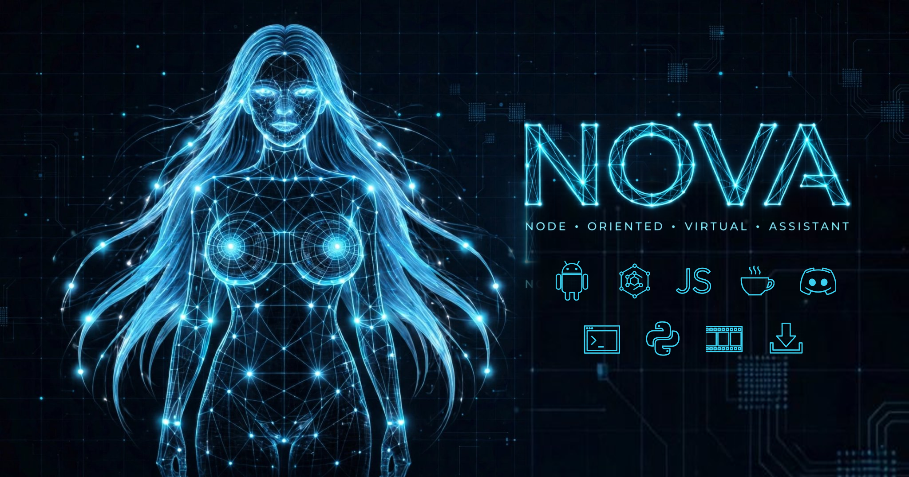

# Nova Bot

> **Your Discord, run from your own bot  and in your pocket.**

Nova Bot is a Discord bot that lives on your Android phone. Install the app, paste in your own bot token, and you get a bot that welcomes members, issues ID-style member cards, runs support tickets and private client areas, collects playlists, moderates, plays music in voice channels, posts news and GitHub feeds, tracks server stats and is controlled end to end from a dashboard inside the app.

No server needed. No hosting bill. No code to write.

---

## In one line

Nova Bot turns an Android phone into a full Discord bot host with a phone dashboard that controls everything, a soundboards to music in voice channels, and 30 plugins that stay off until you switch them on.

## What it does

| Area | What you get |
| --- | --- |
| **Members** | Welcome posts and welcome cards, join DMs, "Become a member" request → admin review → approve / deny, ID-style member cards, role picker (Designer / Developer / Maker of Things), unlock picker |
| **Community** | Leveling and XP, polls, starboard, LFG, affiliate listings, idea board, asset library, forums |
| **Support** | Tickets with private channels and transcripts, contact-us panels, private client areas with their own category, channel, forum, and handoff |
| **Voice** | Music in voice channels (`/play`, `/queue`, `/skip`, `/nowplaying`, `/volume`), a 320-sound soundboard, text-to-speech into voice channels |
| **Content** | YouTube and Suno playlists, news feeds (RSS), GitHub commit / PR / release feeds, Blues News, GIFs |
| **Moderation** | Warn, warnings, timeout, kick, ban, purge — each checks the caller's Discord permissions first |
| **Automation** | Member reminders (`/remind`), auto-posting streams, server stats updated every 10 minutes, guided setup, one-click demo server |
| **Control** | Full dashboard in the app, home-screen Avatar and Stats widgets, terminal, diagnostics, copy-logs |

**37 slash commands**, grouped by who can use them — everyone, voice, personal, moderators, admins, and server owner. Everyday commands also work as text (`!ping`, `!hello`, `!time`, `!profile`, `!yt`, `!gif`).

## How it works?  

Nova Bot is not one program. It is three connected parts:

1. **The Android app is the control panel.** It installs and manages the bot's runtime, holds your token entry, and provides the console: start, stop and restart, a full dashboard, a terminal, diagnostics, widgets, and setup wizards. Everything it shows comes from status and data files the bot itself writes, read fresh each time. It never guesses the bot's state.
2. **The bot engine is where the work happens.** A Node.js program (`bot.js`, with `voice.js`, `pacing.js`, and `traffic.js`) that runs inside Termux on the phone. It holds the live connection to Discord, receives every event and joins, messages, reactions, button taps decides what each enabled plugin should do, and carries it out. It stores one configuration record per server, so two servers running the same bot can behave completely differently.
3. **Discord is where members see the result.** Channels, panels, cards, DMs, voice playback, and stats appear inside Discord, in every server the bot is invited to. There is no separate "active server" to select: joining a server makes the bot live there, with a per-server Stop / Resume switch.

### The one rule that shapes everything

The bot starts as a **blank canvas**. A fresh server gets no channels, no posts, and no automation until its owner picks a layout, generates the pieces they want, and switches each feature on. Nothing happens by accident or by default.

- Every plugin is **off by default**, and enabling one creates nothing by itself and you generate its channel and its panel post, in that order, when you are ready.
- Every auto-posting stream (welcome posts, member cards, join DMs, news, GitHub updates, activity-log lines) starts **off**. A stream that was never switched on never posts, even after a restart.
- Status **cannot lie**. The app judges ONLINE only when the bot's heartbeat is fresh against the phone's own clock (under about 90 seconds old). An old heartbeat reads as DISCONNECTED with "status stale since", never as a hopeful ONLINE.

## Download

**[Download Nova Bot v1.0 Phelsuma (APK, 61 MB)](https://github.com/jordanalbiar/nova-bot/releases/download/v1.0/nova-bot-v1.0-phelsuma.apk)**

First public release — nicknamed Phelsuma, after the day gecko. Install it over any earlier build. See the [v1.0 release notes](https://github.com/jordanalbiar/nova-bot/releases/tag/v1.0) for what's in it.

## Quick start

1. Install the Nova Bot APK on an Android phone (Android 10+).
2. Create your own bot application in the [Discord Developer Portal](https://discord.com/developers/applications), copy its token, and invite it to your server with Administrator.
3. Open Nova Bot, paste the token in the app, and tap **Start Bot**.
4. Run the guided setup in the dashboard — pick a layout, generate the channels and posts you want, switch on the plugins you want.

That is the whole install. No server, no terminal commands, no config files to edit by hand.

## Requirements

| | Minimum | Recommended |
| --- | --- | --- |
| Android | 10 | 10+ |
| RAM | 1 GB | 3 GB |
| Runtime | Termux (installed from the app's setup) | Termux, exempt from battery optimization |
| Discord | Your own bot application + token | Privileged intents on: Server Members, Message Content, Presence |

One bot instance per token. The app never contains your token — it lives only in the app's private storage and in Termux's `~/nova-bot/.env`.

## Built with

- **Node.js 24** — the bot engine, raw Discord gateway (WebSocket) + REST, no AI tokens
- **Java 17 / Android** — the app, dashboard bridge, and home-screen widgets
- **Termux** — the Linux runtime on the phone (Node, Python, curl)
- **Python + Pillow** — member cards, welcome cards, and profile cards, rendered per person at the moment they are needed
- **FFmpeg + yt-dlp** — music playback in voice channels
- **eSpeak NG** — text-to-speech into voice channels
- **Discord.js-style REST** — every action is an individual Discord REST request; listening is a continuous gateway stream

## The honest limits

Nova Bot is transparent about what it cannot do yet — a failed step shows as failed, never under a green checkmark.

- The bot runs on your phone, so it is only online while the phone and Termux are running. A dead phone means a dead bot until you open Termux and restart it.
- Music and voice need the phone's Termux runtime; the app cannot play audio from a cloud browser to your phone.
- Keyword triggers and auto-welcome need the privileged intents above enabled in the Developer Portal, then a bot restart.
- The soundboard list embed shows about 150 of the 320 clips at a time; `/soundboard play` and keyword triggers work for all 320.
- Member-stats updates can hit Discord rate limits (429) on busy servers; the stats pass retries on its own schedule.

## Screenshots

_Screenshots live in the app's Help guide and on the project website — the dashboard, the guided setup, the Servers page, the voice pages, and the widgets._

## Documentation

- **What It Does & How It Works** — the full 16-page capability guide (PDF), also inside the app on the Bot page and the Help guide page.
- **Nova Bot Breakdown Chart** — the feature breakdown (PDF).
- In-app: Help guide, guided setup, and the dashboard Documentation page.

## Contributing

Nova Bot is built by Jordan Albiar — payal.me/jordanalbiar

---

**NOVA — NODE • ORIENTED • VIRTUAL • ASSISTANT**

## Current version

**Nova Bot is currently on v1.0 Phelsuma** — the first public release, themed on the day gecko.

[Download v1.0 Phelsuma (APK, 61 MB)](https://github.com/jordanalbiar/nova-bot/releases/download/v1.0/nova-bot-v1.0-phelsuma.apk) · [v1.0 release notes](https://github.com/jordanalbiar/nova-bot/releases/tag/v1.0)
